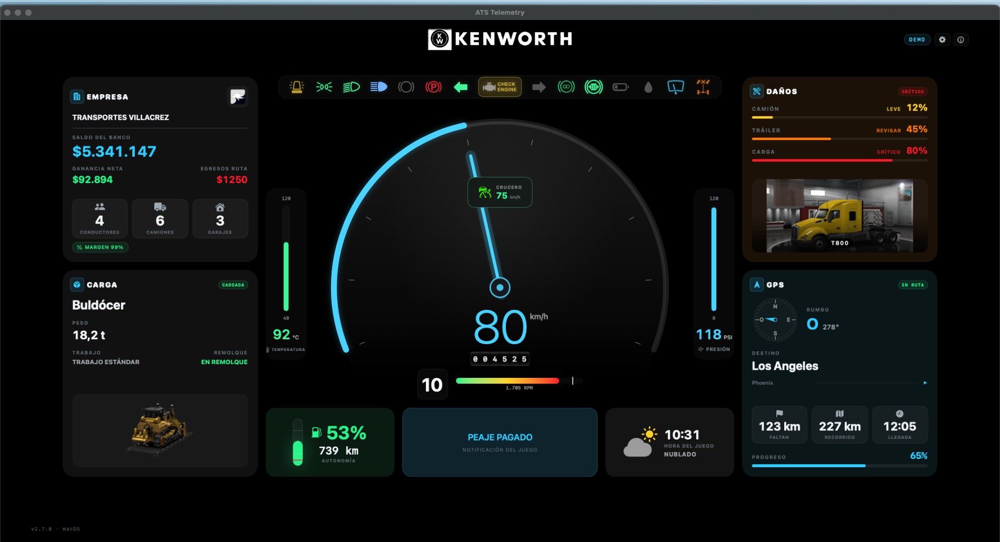

# ATS Telemetry para macOS

Panel nativo de telemetría para **American Truck Simulator (ATS)** y
**Euro Truck Simulator 2 (ETS2)**, pensado para el monitor **PM1562** a
**1920×1080**. Lee `/SCSTelemetry` en modo **solo lectura** y no modifica los
plugins de Ajazz.

> **Estado (23/11/2026):** app macOS **2.7.1** publicada. Corre a **60 FPS**
> con ~30 % de un núcleo, con velocímetro rediseñado (aguja, halo de cristal
> y odómetro de tambor), cabeceras nuevas y panel de combustible simplificado.
> Instalador PKG 2.7.1 con checksum.



---

## Objetivo

Mantener un panel nativo SwiftUI/AppKit con paridad visual respecto a la app
FH6 de Windows, conservando la lectura pasiva de `/SCSTelemetry`:

- Layout FH6 de 1920×1080: cabecera, 13 testigos, cluster central, paneles
  laterales, indicadores verticales de agua/aire y franja inferior.
- **CHECK** oculto sin motor, blanco con motor y amarillo con avería.
- **Chip de crucero** visible solo con el crucero activo, con transición suave.
- **45 imágenes** de camiones con fundido al cambiar de modelo.
- **Telemetría pasiva**: solo lectura de `/SCSTelemetry`.
- Empresa, logo y saldo desde el savegame/perfil.

No requiere .NET, Wine ni Avalonia.

---

## Estado actual (2.7.1 — 23/11/2026)

- Aplicación nativa **SwiftUI + AppKit**, `Package.swift` con macOS 14+.
- Binario `x86_64`, versión **2.7.1**.
- Lectura POSIX de `/SCSTelemetry` y descifrado del savegame ScsC/BSII.
- Renderizado a **60 FPS** con un único reloj de animación.
- Velocímetro de 680 px con aguja, buje, halo de cristal recortado y odómetro
  mecánico de seis ventanas.
- Instalador `.pkg` 2.7.1 con app + plugin de telemetría para ATS/ETS2.

---

## Rendimiento

Medido en modo demo, ventana de 1900×1030 en el PM1562, con delta de tiempo de
CPU (`ps -o time`) sobre ventanas de 15-20 s:

| Configuración | CPU (1 núcleo) | CPU por frame |
|---|---|---|
| Original 2.7.0 (30 FPS) | ~100 % | — |
| Optimizada (30 FPS) | 23,3 % | 7,8 ms |
| **Actual (60 FPS)** | **~28-31 %** | **4,7-5,1 ms** |

El sobrecoste de pasar de 30 a 60 FPS es de solo ~6 puntos porque el trabajo
caro era por segundo y no por frame.

Optimizaciones aplicadas:

- Índice en memoria de las imágenes del bundle, con caché de resolución y de
  fallos (camiones, carga, logos e iconos). Antes se enumeraba el directorio de
  recursos en cada frame desde el `body`.
- `GameMessageStore` solo publica cuando el valor cambia y el contenedor del
  dashboard ya no lo observa: los avisos no invalidan los 30 paneles.
- Fuera el `DispatchQueue.main.async` por frame: los efectos secundarios van a
  un timer de 10 Hz y las métricas a un objeto no observable (`FrameStats`).
- Caché de snapshot con TTL de 20 ms para no releer clima, savegame y memoria
  compartida varias veces por frame.
- Un único `AnimationClock` de 60 Hz; `FrameClock` fuera de `@State` y
  preferencia de movimiento reducido cacheada.

El overlay de diagnóstico (menú de la barra → **Diagnóstico**) muestra FPS y
tiempo de frame en vivo.

---

## Interfaz (2.7.1)

- **Velocímetro**: arco de 224° con marcas sin numeración; aguja con halo y
  buje; cifra de 96 pt bajo el pivote; `km/h` como superíndice; odómetro de
  tambor (`004525`) sin la palabra «km»; marcha y RPM en una fila ancha.
- **Halo de cristal** detrás del cluster, recortado en la parte inferior para
  no tocar las tarjetas compactas (56 px de separación, igual que con los
  gauges laterales).
- **Cabeceras** de EMPRESA, CARGA, DAÑOS y GPS con baldosa de icono, título
  redondeado en peso black y estado como chip.
- **Combustible**: nivel en 38 pt, autonomía con la etiqueta debajo y sin la
  línea de consumo; el tintado verde/naranja/rojo se conserva.
- **Crucero**: el chip aparece solo al activarse, con transición de escala y
  fundido de 0,28 s.
- **CHECK ENGINE**: encuadre amarillo teñido y pulso solo con el testigo activo.
- **GPS**: badges de FALTAN / RECORRIDO / LLEGADA, barra de progreso al pie y
  porcentaje de 19 pt.
- **Avisos** con fondo tintado por tipo, daños con etiqueta de severidad y
  overlay de diagnóstico corregido.

---

## Requisitos

- macOS 14 o superior (Hackintosh Intel; binario `x86_64`).
- Xcode Command Line Tools / Swift 5.9 o superior.
- ATS o ETS2 con el plugin de telemetría macOS instalado.

---

## Compilar y ejecutar

```zsh
chmod +x build_app.sh
./build_app.sh
open "ATS Telemetry.app"
```

Modo demo, sin juego:

```zsh
open "ATS Telemetry.app" --args --demo
```

En modo demo se alternan la hora del juego y los estados de clima para validar
los iconos de día y de noche. En modo real, el clima se infiere de los
limpiabrisas.

---

## Instalador macOS

```bash
bash build_installer.sh
```

Genera `ATS-Telemetry-Installer-2.7.1.pkg`, que:

- Copia `ATS Telemetry.app` a `/Applications`.
- Instala `libscs-telemetry.dylib` en ATS y ETS2 si están instalados y aún no
  tienen el plugin.
- No sobrescribe un plugin existente.
- Deja el registro en `/tmp/ATS-Telemetry-installer.log`.

Checksum de la 2.7.1:

```text
9e47d0b767582a6984213af48c3b31d21bd4af161b634127be267de8243ee930  ATS-Telemetry-Installer-2.7.1.pkg
```

El paquete no está firmado con Developer ID; si macOS lo bloquea, usar clic
derecho sobre el `.pkg` > **Abrir**.

---

## Plugin de telemetría en macOS

La app lee el segmento POSIX `/SCSTelemetry`. El plugin debe estar en la carpeta
`plugins` dentro del paquete de la aplicación del juego:

```text
American Truck Simulator.app/Contents/MacOS/plugins/
Euro Truck Simulator 2.app/Contents/MacOS/plugins/
```

Para macOS se puede usar el build de
[`truckermudgeon/scs-sdk-plugin`](https://github.com/truckermudgeon/scs-sdk-plugin)
(v1.12.1). Verificar que cargue en la versión actual del juego; si el ABI cambió,
hay que recompilarlo desde el código fuente.

Comprobación rápida: con el juego abierto, la app debe mostrar `EN LÍNEA` y el
panel debe recibir datos. Si no, revisar la ruta del plugin y que
`/SCSTelemetry` tenga `SDK=1`.

---

## Menú

Desde el icono de la barra de menús:

- **Pantalla**: selección del monitor y «Pantalla siguiente».
- **Clic a través**: la ventana ignora el ratón.
- **Diagnóstico**: overlay de FPS y tiempo de frame.
- **Tema claro**, **Alto contraste** y **Escala UI** (100/125/150 %).
- **Idioma**: español / inglés.
- **Ventana**: maximizar, minimizar, siempre visible, mover con ratón.
- **Ajustes…**, **Créditos**, **Salir**.

---

## Hora y clima en vivo

- **Hora:** se lee directamente del canal `time_abs` del SDK (`O_TIME_ABS`), en
  minutos de juego. No usa la hora del sistema ni un estado anterior.
- **Clima ATS:** `WeatherReader` lee el objeto `economy` de la build Mac
  1.62.2.2. El puntero está en `__DATA` (`+0x3C18B80`) y los campos de clima en
  `+0x4FC` (timer), `+0x500` (índice) y `+0x5F4` (humedad). Requiere el
  entitlement de depuración para `task_for_pid`; el juego ya trae
  `get-task-allow`.
- **ETS2:** al no haber una build instalada para verificar su offset Mac, el
  panel usa el respaldo en vivo de los limpiabrisas.

---

## Estructura

```text
Mac Os/
  Sources/ATSTelemetry/
    main.swift              Ventana, pantalla y menú
    DashboardView.swift     Dashboard completo (cluster, paneles y avisos)
    TelemetryReader.swift   Offsets REV12, lectura de /SCSTelemetry y caché
    BankBalanceReader.swift Savegame, ScsC/BSII, saldo y perfil
    WeatherReader.swift     Clima en vivo desde la memoria del juego
  Resources/
    Indicators/             Iconos de los 13 testigos
    TruckImages/            45 JPG de camiones
    BrandLogos/ CompanyLogos/ CargoImages/
    Plugins/                libscs-telemetry.dylib
  screenshots/              Capturas de referencia y de la versión actual
  installer/                Scripts preinstall/postinstall del PKG
  game-mode/                Perfil de suavidad y prioridades para ATS/ETS2
  ajustes-noche/            Notas de iluminación nocturna de los juegos
  build_app.sh              Compilación y empaquetado de la app
  build_installer.sh        Generación del instalador PKG
  Info.plist                Metadatos del bundle (2.7.1)
  README.md                 Este documento
  PLAN-TRABAJO.md           Plan histórico por fases
  MEJORAS-INTERFAZ.md       Registro de mejoras visuales
  HISTORIAL.md              Historial de decisiones y pruebas
```

---

## Pruebas

- **Demo**: validada a 1900×1030 y 1280×720; 60 FPS sostenidos y ~28-31 % de
  un núcleo.
- **Interfaz**: verificada con capturas en cada iteración (velocímetro, halo,
  odómetro, cabeceras, combustible y crucero).
- **Modo real**: pendiente de una sesión con ATS/ETS2 abierto para confirmar
  lectura de `/SCSTelemetry`, saldo y clima en vivo.

---

## Documentación relacionada

- [`PLAN-TRABAJO.md`](PLAN-TRABAJO.md): plan por fases de la migración.
- [`MEJORAS-INTERFAZ.md`](MEJORAS-INTERFAZ.md): cambios visuales aplicados.
- [`HISTORIAL.md`](HISTORIAL.md): decisiones y estado de la versión 0.1.0.
- [`ajustes-noche/README.md`](ajustes-noche/README.md): iluminación nocturna
  de ATS/ETS2.
- [`../Windows Native Final/README.md`](../Windows%20Native%20Final/README.md):
  app de referencia en Windows.
